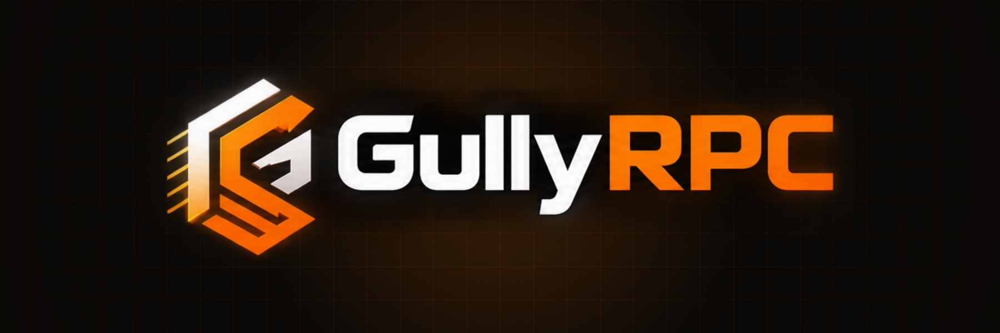

<!-- gully-header:start -->

  <a href="https://gullyrpc.xyz">
    <picture>
      <source media="(prefers-color-scheme: dark)" srcset=".github/assets/gullyrpc-logo-transparent.png">
      
    </picture>
  </a>

<b>Multi-chain RPC gateway and node control plane. Every Gully node, one key.</b>

Grafana, the dashboards behind Gully RPC node and gateway monitoring.

  
  
  
  

A Gully RPC fork of <a href="https://github.com/grafana/grafana">grafana/grafana</a>, maintained by <a href="https://gullylabs.xyz">Gully Labs</a>. It is used under its AGPL-3.0 licence; the upstream LICENSE, copyright and attribution notices are kept unchanged. The upstream README follows below as published. Not affiliated with or endorsed by grafana.

---
<!-- gully-header:end -->

The open-source platform for monitoring and observability

Grafana allows you to query, visualize, alert on and understand your metrics no matter where they are stored. Create, explore, and share dashboards with your team and foster a data-driven culture:

- **Visualizations:** Fast and flexible client side graphs with a multitude of options. Panel plugins offer many different ways to visualize metrics and logs.
- **Dynamic Dashboards:** Create dynamic & reusable dashboards with template variables that appear as dropdowns at the top of the dashboard.
- **Explore Metrics:** Explore your data through ad-hoc queries and dynamic drilldown. Split view and compare different time ranges, queries and data sources side by side.
- **Explore Logs:** Experience the magic of switching from metrics to logs with preserved label filters. Quickly search through all your logs or streaming them live.
- **Alerting:** Visually define alert rules for your most important metrics. Grafana will continuously evaluate and send notifications to systems like Slack, PagerDuty, VictorOps, OpsGenie.
- **Mixed Data Sources:** Mix different data sources in the same graph! You can specify a data source on a per-query basis. This works for even custom datasources.

## Get started

- [Get Grafana](https://grafana.com/get)
- [Installation guides](https://grafana.com/docs/grafana/latest/setup-grafana/installation/)

Unsure if Grafana is for you? Watch Grafana in action on [play.grafana.org](https://play.grafana.org/)!

## Documentation

The Grafana documentation is available at [grafana.com/docs](https://grafana.com/docs/).

## Contributing

If you're interested in contributing to the Grafana project:

- Start by reading the [Contributing guide](https://github.com/grafana/grafana/blob/HEAD/CONTRIBUTING.md).
- Learn how to set up your local environment, in our [Developer guide](https://github.com/grafana/grafana/blob/HEAD/contribute/developer-guide.md).
- Explore our [beginner-friendly issues](https://github.com/grafana/grafana/issues?q=is%3Aopen+is%3Aissue+label%3A%22beginner+friendly%22).
- Look through our [style guide and Storybook](https://developers.grafana.com/ui/latest/index.html).

> Share your contributor experience in our [feedback survey](https://gra.fan/ome) to help us improve.

## Get involved

- Follow [@grafana on X (formerly Twitter)](https://x.com/grafana/).
- Read and subscribe to the [Grafana blog](https://grafana.com/blog/).
- If you have a specific question, check out our [discussion forums](https://community.grafana.com/).
- For general discussions, join us on the [official Slack](https://slack.grafana.com) team.

This project is tested with [BrowserStack](https://www.browserstack.com/).

## License

Grafana is distributed under [AGPL-3.0-only](LICENSE). For Apache-2.0 exceptions, see [LICENSING.md](https://github.com/grafana/grafana/blob/HEAD/LICENSING.md).

<!-- gully-footer:start -->
---

  <a href="https://gullylabs.xyz">
    <picture>
      <source media="(prefers-color-scheme: dark)" srcset=".github/assets/powered-by-gully-labs-dark-2x.png">
      
    </picture>
  </a>

<!-- gully-footer:end -->
